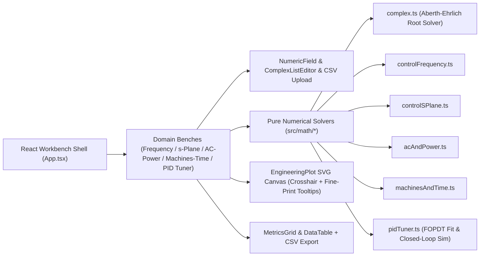

# VectorBench — Electrical & Control Engineering Workbench


**VectorBench** is a client-side electrical and control engineering workbench for plotting, inspecting, and validating transfer functions, stability boundaries, AC circuits, power capability charts, electrical machines, and second-order transient dynamics.

Every instrument accepts live numeric parameter inputs, evaluates deterministic analytical and numerical solvers, renders high-precision SVG plots with crosshair snapping and **fine-print coordinate tooltips**, and supports CSV curve export.

---

## Calibrated Instruments

| # | Instrument | Inputs | Computed Outputs & Plot Overlays |
| --- | --- | --- | --- |
| 01 | **Nyquist Plot** | Open-loop poles, zeros, gain $K$, sweep range, delay $\tau$ | Encirclements $N$, closed-loop RHP poles $Z$, Gain Margin, Phase Margin, vector margin |
| 02 | **Bode Plot** | Poles, zeros, gain $K$, delay $\tau$, lead-lag compensator $C(s)$ | Dual log Magnitude (dB) & Phase (deg), $\omega_{gc}$, $\omega_{pc}$, $-3\text{ dB}$ bandwidth, GM, PM |
| 03 | **Root Locus Plot** | Open-loop poles/zeros, variable gain slider $K$, $K_{\max}$ sweep | Continuous branch trajectories, active poles at $K$, breakaway points, instability gain $K_{\max}$ |
| 04 | **Nichols Chart** | Poles, zeros, gain $K$, frequency sweep bounds | Open-loop gain/phase locus overlaid on constant closed-loop $M$-contours, $M_r$, $\omega_r$ |
| 05 | **Routh–Hurwitz s-Plane** | Characteristic polynomial coefficients $a_n s^n + \dots + a_0$ | Full Routh array ($\epsilon$-sub & auxiliary polynomial support), RHP/LHP root counts, $\omega_{\text{marg}}$ |
| 06 | **Phasor Diagram** | Series/Parallel RLC, $V_{\text{rms}}$, $f$, $R$, $L$, $C$ | Impedance $|Z|$, phase angle $\phi$, $\cos\phi$ (Lead/Lag), $P, Q, S$, resonance $f_0$ |
| 07 | **Power Circle Diagram** | $V_s$, $V_r$, reactance $X$, angle $\delta$, armature/field/turbine limits | Receiving-end power locus, steady-state limit $P_{\max}$, stability margin %, $Q$ bounds |
| 08 | **Torque–Speed Curve** | $V_{LL}$, $f$, motor poles, $R_1, X_1, R_2, X_2$, rated slip | Starting torque, breakdown torque $T_{\max}$ & slip, rated torque, speed regulation % |
| 09 | **Transformer Efficiency** | Rating kVA, core loss $P_i$, copper loss $P_{cu,\text{FL}}$, $\cos\phi$, load $x$ | $\eta(x)$ curve, optimal load $\sqrt{P_i / P_{cu,\text{FL}}}$, $\eta_{\max}$, operating losses |
| 10 | **2nd-Order Step Response** | Damping ratio $\zeta$, natural frequency $\omega_n$, amplitude $A$ | Analytical $y(t)$ across all 4 regimes, decay envelope, $\%OS$, $t_r$, $t_p$, $t_s$ |
| 11 | **CSV Step ID & PID Auto-Tuner** | Step-response CSV $(t, y [, u])$, $\Delta u$, IMC $\lambda$, PID gains | FOPDT fit ($K_p, \tau, \theta, R^2$), ZN/IMC/Cohen–Coon/SIMC/AMIGO gains, closed-loop sim |

---

## System Architecture



---

## Local Development & Verification

```bash
# Install dependencies
npm install

# Start development server on port 3000
npm run dev

# Run TypeScript typecheck
npm run lint

# Run automated unit & integration tests (Vitest + React Testing Library)
npm test

# Build production static bundle
npm run build
```

---

## GitHub Pages Deployment

Automated deployment is configured in `.github/workflows/deploy.yml`. Pushing to `main` runs `npm run lint`, `npm test`, and `npm run build` with `GITHUB_REPOSITORY` injected so `vite.config.ts` resolves the repository `base` path automatically, then publishes `./dist` to GitHub Pages.
